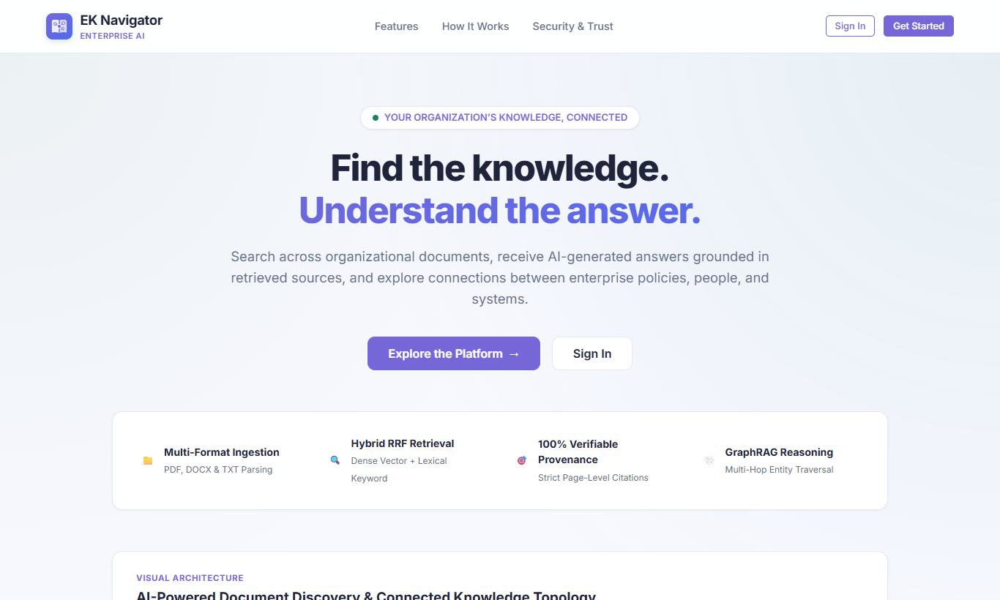
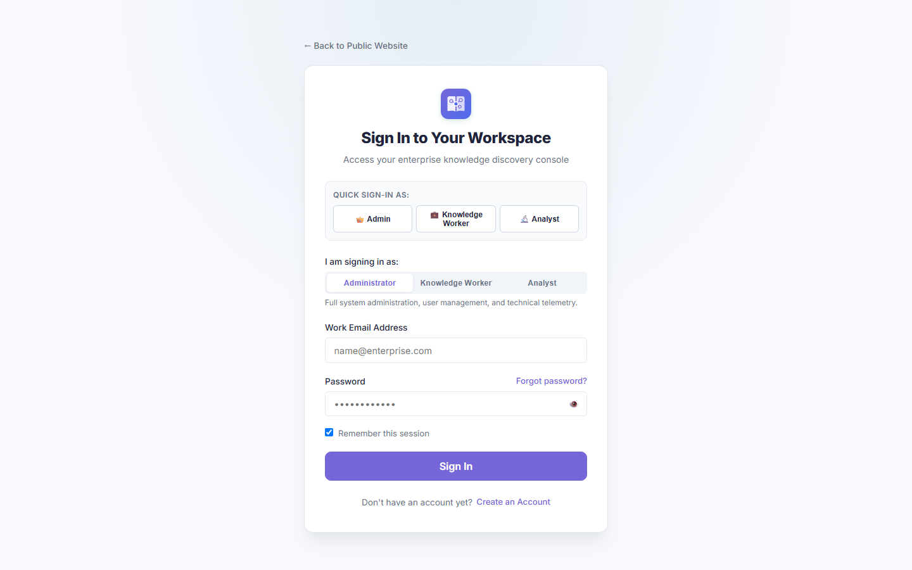
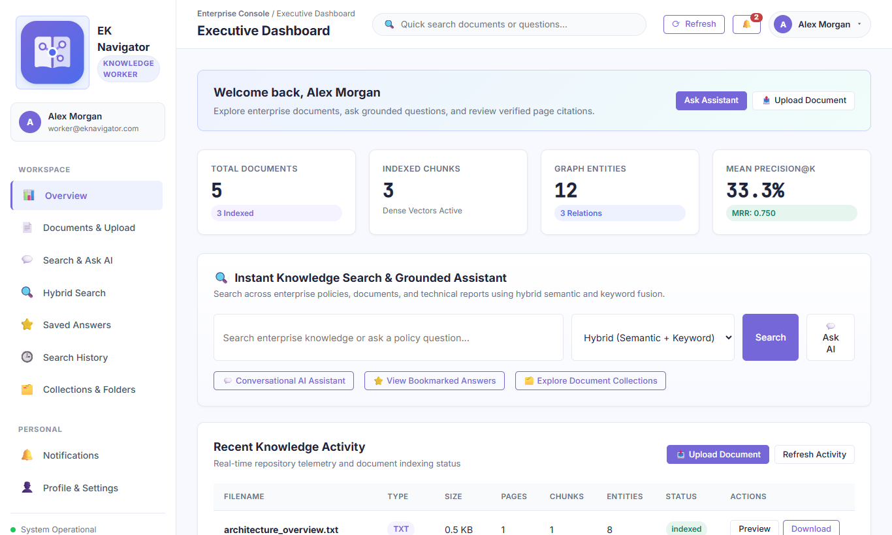
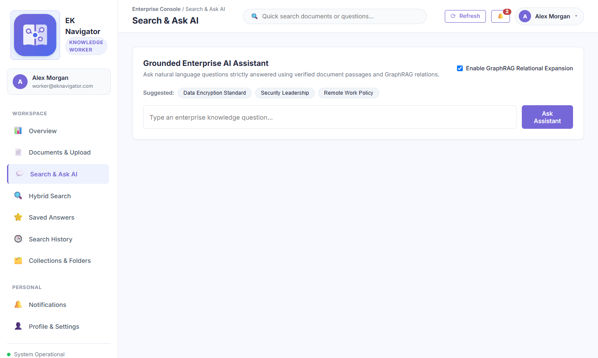
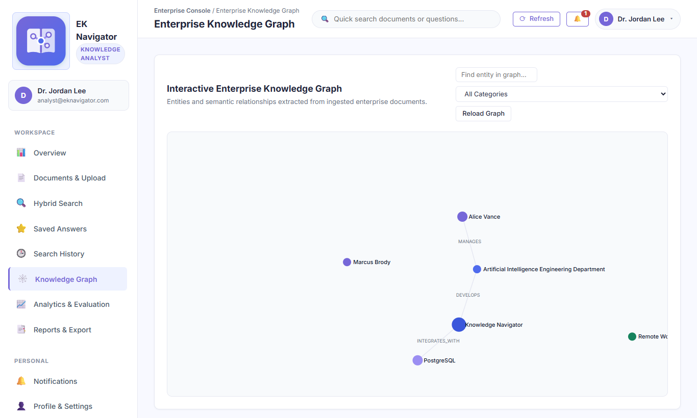
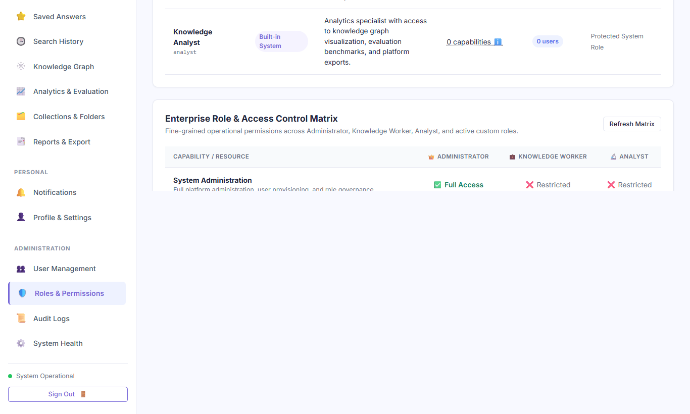
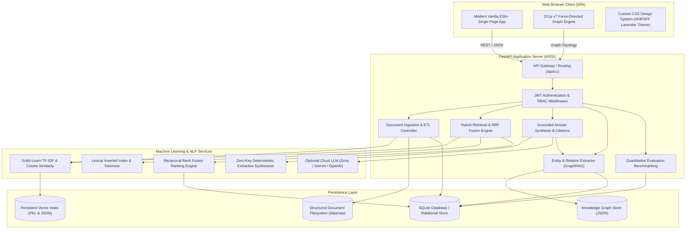

# Enterprise Knowledge Navigator

> **Enterprise Semantic Retrieval, GraphRAG & Institutional Intelligence Platform**  
> *A production-ready, multi-role knowledge management system bridging dense vector semantic retrieval with interactive knowledge graph traversal.*


---

## 1. Introduction

**Enterprise Knowledge Navigator** is a comprehensive, production-compatible enterprise knowledge retrieval and synthesis platform. Modern organizations face severe cognitive overload and knowledge fragmentation across departments, manuals, and unstructured document silos. Traditional keyword searches frequently miss conceptual meaning, while generic Large Language Models (LLMs) often hallucinate answers and lack verifiable institutional attribution.

Enterprise Knowledge Navigator solves these challenges by combining:
1. **Lexical Keyword Search (BM25 tokenization)** and **Dense Semantic Vector Space Modeling (TF-IDF with Cosine Similarity)** via **Reciprocal Rank Fusion (RRF)**.
2. **Interactive Knowledge Graph Traversal (GraphRAG)** for multi-hop semantic relationship expansion across corporate entities, policies, and products.
3. **Deterministic, Zero-Key Grounded Extractive Synthesis** that verifies claims sentence-by-sentence and delivers page-precise citations `[Document Name, Page X]`.
4. **Strict Abstention Protocols** that refuse to hallucinate when evidence is absent from the organizational corpus.
5. **Multi-Tenant Role-Based Access Control (RBAC)** and **Custom Role Governance** tailored for Administrators, Knowledge Analysts, and Knowledge Workers.

---

## 2. Problem Statement

Enterprise internal knowledge bases suffer from three critical bottlenecks:
- **Information Siloing & Unstructured Formats**: Critical operational data is trapped across disconnected PDFs, Word documents (`.docx`), and text manuals (`.txt`).
- **Semantic Blindness of Classic Search**: Standard search engines fail when queries paraphrase source text or require cross-document concept linking.
- **LLM Hallucination & Lack of Attribution**: Generative AI tools often fabricate plausible-sounding answers without verifiable sources, creating compliance, legal, and operational risks.

---

## 3. Project Objectives

1. **Deterministic Attribution**: Guarantee that every fact in generated responses traces directly to an indexed enterprise passage with exact document, page, and chunk metadata.
2. **Hallucination Prevention**: Strictly abstain (`confidence: 0.0`, status: `abstained`) when answering questions outside the verified organizational corpus.
3. **Operational Role Isolation**: Provide dedicated, secure interfaces tailored to Administrators, Knowledge Analysts, and Knowledge Workers.
4. **Flexible & Extensible RBAC**: Support built-in system roles and enable administrators to configure dynamic custom roles with granular platform capabilities.
5. **Zero-Key Local Capability with Cloud LLM Extension**: Provide deterministic local extractive synthesis out-of-the-box without requiring third-party API keys, while supporting optional cloud LLM providers (Groq, Gemini, OpenAI).
6. **Production-Ready Portability**: Designed for containerized and reproducible environments with clean dependency isolation, automated CI/CD validation pipelines, and portable SQLite storage.

---

## 4. Key Features

- **Document Ingestion Engine**: Automated multi-format parsing for PDF, DOCX, and TXT files, recursive text extraction, dynamic chunking with customizable token windows and overlaps, and SHA-256 duplicate prevention.
- **Hybrid Retrieval Engine**: Multi-mode retrieval supporting Keyword (Lexical), Vector (Dense Semantic), and Hybrid Fusion scoring with configurable weighting.
- **Grounded AI Assistant & Verifiable Citations**: Factual answer synthesis engine that cross-references assertions against physical SQLite chunks and outputs interactive citation links.
- **Interactive Knowledge Graph & GraphRAG**: Automatic entity extraction (`PERSON`, `ORG`, `TECH`, `PRODUCT`, `POLICY`) and relational link extraction rendered with D3.js force-directed physics, with multi-hop context expansion during RAG retrieval.
- **Enterprise Role-Based Access Control**: Strict privilege separation across API endpoints and UI views, with public registration restricted to non-privileged roles.
- **Dynamic Custom Role Governance**: Administrative UI and REST API for creating, editing, and safely deleting custom enterprise roles with granular capability sets and user assignment deletion protection.
- **Password Recovery & OTP Security**: Cryptographically secure 6-digit OTP verification with rate limiting, attempt decrement, resend cooldown, and timing-safe SHA-256 hashing.
- **Quality & Retrieval Benchmarks**: Built-in quantitative evaluation engine computing Precision@K, Recall@K, Mean Reciprocal Rank (MRR), Groundedness Ratio, and query latency with persistent historical tracking.
- **Workspace Productivity Suite**: Document categorization collections, saved answers, bookmarked insights, persistent search audit history, and notification feeds.
- **Data Export Center**: Instant export of catalog records, evaluation benchmarks, and operational audit logs into CSV and JSON formats.

---

## 5. Intended Users & Built-in Roles

Enterprise Knowledge Navigator provides three distinct built-in user roles, each with its own workflow and permissions:

```
┌────────────────────────────────────────────────────────────────────────┐
│                        ROLE SEPARATION MATRIX                          │
├───────────────────────┬───────────────────────┬────────────────────────┤
│     Administrator     │   Knowledge Analyst   │    Knowledge Worker    │
├───────────────────────┼───────────────────────┼────────────────────────┤
│ • Full platform admin │ • Advanced analytics  │ • Daily operations     │
│ • User provisioning   │ • Knowledge graph     │ • Document upload      │
│ • Custom role manager │ • Quality benchmarks  │ • Hybrid search        │
│ • Audit log inspector │ • Evaluation history  │ • Grounded Q&A         │
│ • System telemetry    │ • Data exports        │ • Collections & saves  │
│ • All 11 capabilities │ • 6 capabilities      │ • 5 capabilities       │
└───────────────────────┴───────────────────────┴────────────────────────┘
```

### 1. Administrator
- **Persona**: Enterprise IT directors, compliance officers, and system administrators.
- **Capabilities**: All 11 platform capabilities. Access to user directories, account activation/deactivation, password resets, custom role creation/deletion, tamper-evident audit logs, and technical telemetry.
- **Guardrails**: Cannot delete or deactivate their own administrator account; protected against deletion of system built-in roles.

### 2. Knowledge Analyst
- **Persona**: Intelligence specialists, research analysts, and quality assurance engineers.
- **Capabilities**: 6 analytics and intelligence capabilities (`search_retrieval`, `qa_citations`, `knowledge_graph`, `evaluation`, `export_center`, `profile_settings`).
- **Dashboard Experience**: Tailored analytics overview with direct access to Knowledge Graph exploration, GraphRAG relationship topology, Precision/Recall/MRR benchmarking, and catalog exports.
- **Guardrails**: Blocked with `HTTP 403 Forbidden` from administrative endpoints (`/auth/users`, `/auth/admin/roles`, `/auth/admin/audit-logs`).

### 3. Knowledge Worker
- **Persona**: General employees, business analysts, engineers, and operational staff.
- **Capabilities**: 5 core operational capabilities (`doc_ingestion`, `doc_deletion`, `search_retrieval`, `qa_citations`, `profile_settings`).
- **Dashboard Experience**: Operational overview focused on rapid document discovery, uploading departmental manuals, asking grounded questions, reviewing verified citations, and organizing research in personal collections.
- **Guardrails**: System administration, custom role management, and deep evaluation suites are hidden and protected on the backend.

---

## 6. Custom Role Management

In addition to built-in roles, administrators can create and manage custom roles using standardized platform capabilities:

| Capability ID | Name | Category | Description |
| :--- | :--- | :--- | :--- |
| `system_admin` | System Administration | Administration | Full platform governance, user provisioning, and role management |
| `audit_logs` | Operational Audit Logs | Administration | Inspect system security logs and tamper-evident operational events |
| `system_health` | System Diagnostics | Administration | Monitor storage persistence, vector space, and pipeline health |
| `doc_ingestion` | Document Ingestion | Content & Search | Upload enterprise PDF, DOCX, and TXT files for indexing |
| `doc_deletion` | Document Deletion | Content & Search | Permanently delete documents and purge relational graph edges |
| `search_retrieval` | Hybrid Search | Content & Search | Execute lexical, dense vector, and hybrid rank queries |
| `qa_citations` | Grounded AI Q&A | Content & Search | Ask natural language questions with verified page citations |
| `knowledge_graph` | Knowledge Graph | Analytics & Intel | Explore semantic entity relationships and GraphRAG evidence |
| `evaluation` | Quality Benchmarks | Analytics & Intel | Run Precision@K, Recall@K, and MRR evaluation suites |
| `export_center` | Data Export Center | Analytics & Intel | Export catalog records, evaluation logs, and audit trails |
| `profile_settings` | Profile Settings | General | Manage personal credentials, contact info, and preferences |

**Safety Guardrails**:
- Built-in roles (`admin`, `analyst`, `knowledge_worker`) cannot be renamed or deleted.
- Custom roles assigned to active users cannot be deleted until users are reassigned (`HTTP 400 Bad Request`).
- Public self-registration cannot select administrator or privileged roles (`HTTP 403 Forbidden`).

---

## 7. Application Interface & Visual Showcase

The platform provides a responsive, single-page web interface built with modern vanilla ES6+ JavaScript, CSS3 design tokens, and D3.js v7:

| Application View | Interface Screenshot | Capabilities Demonstrated |
| :--- | :--- | :--- |
| **Public Landing Page** |  | Unified entry portal with interactive pipeline demonstration, architectural highlights, and direct role navigation. |
| **Authentication & Role Selection** |  | Secure login portal with role quick-access selectors (Administrator, Knowledge Worker, Analyst) and password recovery. |
| **Executive Operations Dashboard** |  | Real-time system telemetry, indexed document catalog, vector chunk metrics, and instant hybrid search interface. |
| **Grounded AI Q&A Assistant** |  | Factual natural-language Q&A engine with toggleable GraphRAG expansion, compliance suggestions, and verified page citations. |
| **Interactive D3.js Knowledge Graph** |  | Force-directed entity-relationship network visualizer mapping institutional policies, leadership, and cross-department links. |
| **Administrative Governance & RBAC** |  | Fine-grained capability matrix across system roles, user provisioning, and tamper-evident audit logs. |

---

## 8. Technical Architecture



---

## 9. Technology Stack

### Backend
- **Framework**: Python 3.11+ / Python 3.14 on FastAPI (Starlette ASGI)
- **ASGI Server**: Uvicorn with single-worker concurrency safety for SQLite
- **Configuration & Validation**: Pydantic v2, Pydantic-Settings, Python-Dotenv
- **Relational Database**: SQLAlchemy ORM with SQLite (PostgreSQL compatible)
- **Logging**: Rotating file and console structured logging

### Machine Learning, Retrieval & NLP
- **Statistical Vector Retrieval**: Scikit-Learn `TfidfVectorizer` (sublinear TF scaling, n-grams 1-2, English stop-words) with Cosine Similarity
- **Lexical Keyword Retrieval**: BM25 frequency-density scoring and exact multi-word phrase matching
- **Hybrid Fusion**: Reciprocal Rank Fusion (RRF) with configurable modality weights ($k = 60$)
- **Optional Dense Embeddings**: Sentence-Transformers neural embedders (`sentence-transformers/all-MiniLM-L6-v2`) when installed
- **Document Processing**: `pypdf` / `PyPDF2` (PDF extraction), `python-docx` (Word DOCX extraction), UTF-8 / NFKC Unicode normalization, and optional OCR fallback (`pytesseract`, `pdf2image`) for scanned PDFs
- **Knowledge Graph**: Rule-based entity recognition (`PERSON`, `ORG`, `TECH`, `PRODUCT`, `POLICY`) and relational triple extraction
- **Optional Cloud AI**: Groq SDK (`llama-3.3-70b-versatile`), Google Gemini, and OpenAI API integrations

### Security & Authentication
- **Password Hashing**: `passlib` with `bcrypt` salt generation
- **Session Tokens**: Signed Bearer JWTs via `python-jose` (HS256)
- **Production Secret Validation**: Mandatory 32+ character non-default `SECRET_KEY` in production environments
- **Multi-Tenant Document Access Control**: Role and owner-based document access isolation (`public`, `internal`, `confidential`, `restricted`) across search, RAG Q&A, and knowledge graph
- **Demo Account Gating**: `ENABLE_DEMO_ACCOUNTS` setting (enabled in dev, strictly disabled in production)
- **Prompt Injection Defense**: Multi-pattern jailbreak filtering and strict isolation of embedded document instructions as untrusted data
- **OTP Recovery**: Cryptographically secure numeric OTPs, timing-attack safe `secrets.compare_digest` verification

### Frontend
- **Architecture**: Single Page Application (SPA) served directly through FastAPI static files
- **Languages**: Modern ES6+ JavaScript, Semantic HTML5, CSS3 Custom Properties
- **Visualization**: D3.js v7 for force-directed dynamic knowledge graphs
- **Theme**: Light lavender-blue enterprise palette (`#F8F9FF` background, `#7667D8` lavender, `#4F6BED` blue)

---

## 10. AI, NLP & Retrieval Methodologies

### Lexical Retrieval vs. Dense Vector Retrieval
Enterprise Knowledge Navigator clearly distinguishes between retrieval paradigms:
- **Lexical BM25 Retrieval**: Matches query keywords, acronyms, and multi-word n-gram phrases against indexed document tokens. Effective for specific code identifiers, acronyms, policy numbers, and verbatim phrases.
- **Statistical Vector Space Modeling (TF-IDF)**: Projects text into a high-dimensional vocabulary vector space with sublinear term-frequency scaling and cosine similarity. Captures thematic relevance without external API dependencies.
- **Dense Neural Embeddings (Optional)**: Maps queries and passages into dense continuous vector spaces using pre-trained sentence transformer models when installed.
- **Hybrid Reciprocal Rank Fusion (RRF)**: Merges ranked candidate lists from both modalities:
  $$\text{RRF Score}(d) = \sum_{m \in \{\text{vector}, \text{keyword}\}} \frac{w_m}{k + \text{Rank}_m(d)}$$
  *(where $k = 60$ and $w_m$ represents modality weight).*

### Document Ingestion & Chunking
1. **Extraction & Sanitization**: Safe text stream extraction from PDF, Word DOCX, and TXT files with Unicode NFKC normalization and control character sanitization.
2. **Duplicate Detection**: Content hash computed via SHA-256 before disk writes. Identical files return `HTTP 409 Conflict`.
3. **Sliding-Window Chunking**: Splits extracted document text into chunks of 400 tokens with a 60-token overlap, preserving cross-sentence context boundaries.
4. **Metadata Preservation**: Every chunk retains its `document_id`, `chunk_index`, `page_number`, token count, and access tenancy tags.

### Grounded Answer Synthesis & Verifiable Citations
- Responses are synthesized strictly from retrieved passages.
- In zero-key mode, the deterministic extractive engine selects top-scoring grounded assertions, cross-verifies sentences against SQLite source chunks, and appends explicit citations in `[Filename, Page X, Chunk Y]` format.
- If retrieved passage similarity falls below the confidence threshold, the assistant abstains with: *"I could not find sufficient information in the indexed enterprise documents to answer this question."*

### Multi-Tenant Access Control & Cross-User Document Isolation
- Documents can be tagged with access tiers: `public`, `internal`, `confidential`, or `restricted`.
- Confidential and restricted documents are strictly filtered out of search results, retrieved chunks, RAG answers, citations, and Knowledge Graph visualizations for unauthorized roles.
- Document deletion is strictly authorized: only document owners or system administrators can delete documents.

### Knowledge Graph & GraphRAG
- Evaluates entity co-occurrences and semantic patterns to build an entity-relationship network.
- During query synthesis, GraphRAG extracts neighboring nodes within $k$-hops of identified entities to inject structural relational context into the prompt, respecting document access boundaries.

---

## 11. Evaluation Benchmarking Metrics

The system includes a dedicated evaluation pipeline measuring retrieval performance across five key metrics:

| Metric | Calculation Method | Target Threshold |
| :--- | :--- | :--- |
| **Precision@K** | Ratio of relevant retrieved chunks among top-K results | $\ge 80\%$ |
| **Recall@K** | Ratio of relevant chunks retrieved out of total ground truth chunks | $\ge 85\%$ |
| **MRR (Mean Reciprocal Rank)** | Average reciprocal rank of the first relevant retrieved document: $\frac{1}{|Q|}\sum_{i=1}^{|Q|}\frac{1}{\text{rank}_i}$ | $\ge 0.75$ |
| **Groundedness Ratio** | Percentage of synthesized response claims backed by database passage citations | $100\%$ |
| **Average Query Latency** | End-to-end retrieval, fusion, and synthesis execution duration | $< 150\text{ ms}$ |

---

## 12. Directory Structure

```
enterprise-knowledge-navigator/
├── .github/
│   └── workflows/
│       └── ci.yml               # GitHub Actions automated test & deployment trigger
├── backend/
│   └── app/
│       ├── api/v1/
│       │   ├── __init__.py      # API router aggregator
│       │   ├── auth.py          # Authentication, OTP, user management, custom roles
│       │   ├── health.py        # System health and diagnostic probes
│       │   ├── navigator.py     # Document ingestion, search, RAG Q&A, graph, evaluation
│       │   └── workspace.py     # Collections, bookmarks, history, notifications, export
│       ├── core/
│       │   ├── config.py        # Pydantic BaseSettings, dynamic PORT and DATA_DIR
│       │   ├── database.py      # SQLAlchemy engine, session maker, schema upgrades
│       │   ├── logging.py       # Rotating file and console structured logging
│       │   └── security.py      # Passlib bcrypt hashing, JWT token creation and decoding
│       ├── models/
│       │   ├── document.py      # DocumentRecord, ChunkRecord, EntityRecord, RelationRecord
│       │   ├── user.py          # UserRecord, RoleRecord, PasswordResetOTPRecord, AuditLogRecord
│       │   └── workspace_extras.py # CollectionRecord, SavedAnswerRecord, SearchHistoryRecord
│       ├── schemas/
│       │   ├── auth.py          # Pydantic schemas for authentication and custom roles
│       │   ├── health.py        # Health and system info schemas
│       │   ├── navigator.py     # Document, search, RAG, citations, and graph schemas
│       │   └── workspace_extras.py # Collections, bookmarks, and preferences schemas
│       ├── services/
│       │   ├── document_processor.py # PDF/DOCX/TXT extraction, chunking, SHA-256 hash
│       │   ├── evaluation_service.py # Precision@K, Recall@K, MRR evaluation benchmarks
│       │   ├── knowledge_graph.py    # Rule-based entity & relation graph extractor
│       │   ├── notification_delivery.py # OTP delivery and audit logging
│       │   ├── rag_assistant.py      # Grounded answer synthesis, citation validation
│       │   └── vector_index.py       # TF-IDF vectorization, hybrid fusion search
│       └── main.py              # FastAPI application initialization and SPA routing
├── data/
│   ├── graph_store/             # Knowledge graph JSON artifacts
│   ├── processed/               # Extracted clean text cache
│   ├── raw/                     # Uploaded documents
│   └── vector_store/            # Serialized TF-IDF indices and chunk metadata
├── deploy/
│   ├── Caddyfile                # Optional Caddy reverse proxy configuration
│   └── nginx.conf               # Optional Nginx reverse proxy configuration
├── docs/                        # Architecture guides, audit logs, and technical reports
│   ├── diagrams/                # Architectural flowcharts and system diagrams
│   └── screenshots/             # Genuine captures of the running web application
├── frontend/
│   ├── app.js                   # Client-side SPA controller and D3.js graph visualizer
│   ├── index.html               # Semantic HTML5 layout and role-tailored dashboard shells
│   └── style.css                # CSS custom properties and responsive stylesheet
├── scripts/
│   ├── capture_genuine_screenshots.py # Playwright automated screenshot capture utility
│   └── comprehensive_final_audit.py   # Deep 29-check end-to-end verification script
├── tests/                       # Complete automated pytest test suite (58 tests)
│   ├── test_accuracy_benchmark.py
│   ├── test_auth_and_roles.py
│   ├── test_edge_cases_and_resilience.py
│   ├── test_foundation.py
│   ├── test_full_pipeline_verification.py
│   ├── test_ml_engine.py
│   ├── test_navigator_pipeline.py
│   └── test_workspace_features.py
├── .env.example                 # Safe environment template with placeholder values
├── .gitignore                   # Comprehensive exclusion of secrets, DBs, and runtime data
├── Dockerfile                   # Multi-stage production container definition
├── render.yaml                  # Application deployment blueprint (dormant reference)
├── requirements.txt             # Pinned production Python dependencies
└── run.py                       # Application startup launcher
```

---

## 13. Local Installation & Setup

Enterprise Knowledge Navigator is designed to run seamlessly in a local development environment. Both the FastAPI backend and modern single-page frontend (HTML5/CSS3/JavaScript/D3.js) are served concurrently through a unified ASGI web server on localhost.

### Prerequisites
- **Python**: Version 3.11 or higher (Python 3.12, 3.13, and 3.14 fully supported)
- **Git**: Version 2.30+
- **Operating System**: Windows 10/11, macOS, or modern Linux distribution (Ubuntu 22.04+)
- **Hardware**: Minimum 4 GB RAM (8 GB recommended for local vector indexing)

### Step-by-Step Installation

1. **Clone the repository:**
   ```bash
   git clone https://github.com/shweeta1015/enterprise-knowledge-navigator.git
   cd enterprise-knowledge-navigator
   ```

2. **Create and activate a dedicated virtual environment:**
   - **Linux / macOS:**
     ```bash
     python3 -m venv venv
     source venv/bin/activate
     ```
   - **Windows (PowerShell):**
     ```powershell
     python -m venv venv
     .\venv\Scripts\Activate.ps1
     ```

3. **Install pinned dependencies:**
   ```bash
   pip install -r requirements.txt
   ```

4. **Initialize local environment configuration:**
   Copy the safe `.env.example` template to `.env`:
   - **Linux / macOS:**
     ```bash
     cp .env.example .env
     ```
   - **Windows (PowerShell):**
     ```powershell
     Copy-Item .env.example .env
     ```
   *(The default settings in `.env.example` are pre-configured for instant zero-key localhost execution with SQLite).*

5. **Start the local server:**
   Launch the unified application launcher:
   ```bash
   python run.py
   ```
   *Alternative direct Uvicorn command:*
   ```bash
   uvicorn backend.app.main:app --host 127.0.0.1 --port 8000 --reload
   ```

6. **Localhost Application URLs & Health Verification:**
   Once started, access the running application using the following local addresses:

   | Destination | Localhost URL | Description |
   | :--- | :--- | :--- |
   | **Web Application UI** | [http://127.0.0.1:8000/](http://127.0.0.1:8000/) | Full single-page enterprise web application |
   | **Alternative UI URL** | [http://localhost:8000/](http://localhost:8000/) | Same application interface via hostname |
   | **Interactive Swagger API** | [http://127.0.0.1:8000/docs](http://127.0.0.1:8000/docs) | OpenAPI interactive endpoint test console |
   | **ReDoc API Documentation** | [http://127.0.0.1:8000/redoc](http://127.0.0.1:8000/redoc) | Clean offline API specification reference |
   | **System Health Probe** | [http://127.0.0.1:8000/api/v1/health](http://127.0.0.1:8000/api/v1/health) | Real-time database and storage health status |

7. **Verifying System Health via Terminal:**
   You can verify that the local server is healthy and fully operational using `curl` or PowerShell:
   - **PowerShell:**
     ```powershell
     Invoke-RestMethod -Uri "http://127.0.0.1:8000/api/v1/health" | ConvertTo-Json
     ```
   - **Bash / curl:**
     ```bash
     curl -s http://127.0.0.1:8000/api/v1/health | jq .
     ```
   Expected response:
   ```json
   {
     "status": "healthy",
     "version": "0.1.0",
     "environment": "development",
     "database_connected": true,
     "storage_directories_ready": true,
     "active_providers": {
       "llm_provider": "groq",
       "embedding_provider": "huggingface"
     }
   }
   ```

---

## 14. Pre-Seeded Default Accounts & Access Roles

During initial local database bootstrapping, the application initializes default accounts representing each built-in role to facilitate evaluation:

| Role | Account Identifier | Access Level & Scope |
| :--- | :--- | :--- |
| **Administrator** | `admin@eknavigator.com` | Full platform administration, user directory, role governance, and audit logs |
| **Knowledge Analyst** | `analyst@eknavigator.com` | Knowledge Graph navigation, evaluation benchmarks, and data export |
| **Knowledge Worker** | `worker@eknavigator.com` | Document ingestion, multi-format catalog, hybrid search, and grounded Q&A |

### Safe Local Setup & Authentication

1. **Local Demonstration Login**: When running locally on localhost, the single-page login screen provides convenient role quick-fill buttons for rapid demonstration without requiring manual credential entry.
2. **Self-Registration**: New local worker accounts can be created directly using the **Create an Account** portal on the login screen ([http://127.0.0.1:8000/](http://127.0.0.1:8000/)).
3. **Privilege Hardening for Shared/Production Environments**: In production or multi-user environments, default administrator credentials must be changed immediately upon initialization through the Profile & Settings menu, or supplied via secure environment variables prior to initial database bootstrapping.

---

## 15. Running Tests

The test suite validates database models, security, authorization, document processing, and hybrid retrieval.

### Run Full Pytest Suite (58 Tests)
```bash
python -m pytest tests -v
```

### Run Comprehensive 29-Check Audit Script
```bash
python scripts/comprehensive_final_audit.py
```

---

## 16. Local Development & Git Synchronization Workflow

The project follows a disciplined local engineering and version control workflow:

```
┌──────────────────────────────────────────────┐
│ Local Development in Antigravity Workspace   │
│ - Backend: FastAPI, SQLAlchemy, Scikit-Learn │
│ - Frontend: HTML5, CSS3, ES6 JS, D3.js       │
└──────────────────────┬───────────────────────┘
                       │ 1. Local Code Updates & Verification
                       ▼
┌──────────────────────────────────────────────┐
│ Local Automated Quality & Verification Suite │
│ - pytest tests -v (58 Unit & Integration)    │
│ - python scripts/comprehensive_final_audit.py│
└──────────────────────┬───────────────────────┘
                       │ 2. Stage verified code (excluding secrets, DBs, uploads)
                       ▼
┌──────────────────────────────────────────────┐
│ Commit & Push to GitHub (main branch)        │
│ git push origin main                         │
└──────────────────────┬───────────────────────┘
                       │ 3. Automated CI Validation on Ubuntu Linux
                       ▼
┌──────────────────────────────────────────────┐
│ GitHub Actions CI Pipeline (Passing 100%)    │
│ - Compiles syntax across all modules         │
│ - Executes full pytest suite                 │
│ - Runs 29-check comprehensive audit script   │
└──────────────────────────────────────────────┘
```

1. **Local Development**: Develop and test features directly against the local SQLite database and ASGI server on `http://127.0.0.1:8000/`.
2. **Local Validation**: Run `pytest tests -v` and `python scripts/comprehensive_final_audit.py` to confirm zero regressions.
3. **Data Protection**: Ensure private databases (`*.db`), `.env` files, logs, and user-uploaded raw files remain strictly untracked and excluded via `.gitignore`.
4. **Git Synchronization**: Push clean commits to `https://github.com/shweeta1015/enterprise-knowledge-navigator.git`.
5. **Continuous Integration**: GitHub Actions CI independently tests every pushed commit on a clean Ubuntu Linux container to guarantee portability.

---

## 17. Security & Privacy Notes

- **Password Security**: All user passwords are encrypted using bcrypt with per-user salt.
- **Signed Tokens**: JWT session tokens are signed with HS256 and subject to strict expiration (`ACCESS_TOKEN_EXPIRE_MINUTES`).
- **Privilege Escalation Protection**: Public self-registration is strictly restricted from assigning the `admin` role or privileged system capabilities.
- **Grounded Verification**: Answers require verified database overlap to avoid fabricated statements.
- **Prompt Injection Defense**: Security filters inspect incoming prompts for delimiter injection and role-play override attempts.

---

## 18. Current Limitations

- **OCR for Scanned Documents**: Documents lacking digital text streams (pure rasterized scanned images) are flagged with an unprocessable warning (`status: error`). Optical Character Recognition (Tesseract) can be integrated in future releases.
- **Vector Space Scaling**: The built-in TF-IDF hybrid retrieval engine is optimized for single-node deployments up to 25,000 document passages. For ultra-scale corpora (>100,000 documents), horizontal vector backends such as `pgvector` or `HNSWLib` can be connected.

---

## 19. Troubleshooting

| Symptom | Cause | Resolution |
| :--- | :--- | :--- |
| `HTTP 409 Conflict` on document upload | Document with identical SHA-256 hash already exists | Rename or verify whether file is already indexed in Document Library. |
| `HTTP 422 Unprocessable` on PDF | PDF contains only raster images and no extractable text | Convert PDF with digital text layer or export from source Word processor. |
| `HTTP 403 Forbidden` on admin endpoints | Authenticated caller lacks `system_admin` capability | Sign in with an Administrator account (`admin@eknavigator.com`). |
| Port binding error on startup | Port 8000 already occupied by another service | Set `PORT=8080` in your `.env` or pass `--port <available_port>` to uvicorn. |

---

## 20. License

This project is licensed under the [MIT License](LICENSE).
