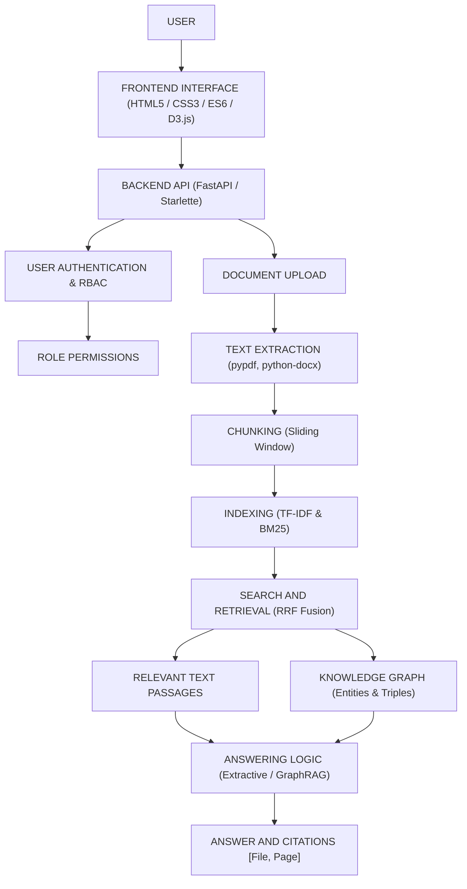

# Enterprise Knowledge Navigator

> **Enterprise Semantic Retrieval, GraphRAG & Institutional Intelligence Platform**  
> An enterprise document search and knowledge discovery platform that helps users find information in organizational documents, ask questions in natural language, explore knowledge relationships, and verify answers through source citations.

---

## Table of Contents

- [1. Project Overview](#1-project-overview)
- [2. Problem Statement](#2-problem-statement)
- [3. Objectives](#3-objectives)
- [4. Who Can Use This Project?](#4-who-can-use-this-project)
- [5. Key Features](#5-key-features)
  - [5.1 Document Management](#51-document-management)
  - [5.2 Search and Retrieval](#52-search-and-retrieval)
  - [5.3 Grounded Question Answering](#53-grounded-question-answering)
  - [5.4 Knowledge Graph and GraphRAG](#54-knowledge-graph-and-graphrag)
  - [5.5 User and Access Management](#55-user-and-access-management)
  - [5.6 Evaluation and Export](#56-evaluation-and-export)
  - [5.7 Additional Workspace Features](#57-additional-workspace-features)
- [6. User Roles](#6-user-roles)
  - [6.1 Administrator](#61-administrator)
  - [6.2 Knowledge Worker](#62-knowledge-worker)
  - [6.3 Analyst](#63-analyst)
- [7. Technology Stack](#7-technology-stack)
- [8. Machine Learning and Retrieval Techniques](#8-machine-learning-and-retrieval-techniques)
  - [8.1 TF-IDF](#81-tf-idf)
  - [8.2 Cosine Similarity](#82-cosine-similarity)
  - [8.3 BM25](#83-bm25)
  - [8.4 Reciprocal Rank Fusion](#84-reciprocal-rank-fusion)
  - [8.5 Entity and Relationship Extraction](#85-entity-and-relationship-extraction)
  - [8.6 Knowledge Graph and GraphRAG](#86-knowledge-graph-and-graphrag)
- [9. How the System Works](#9-how-the-system-works)
- [10. System Architecture](#10-system-architecture)
- [11. Project Structure](#11-project-structure)
- [12. Installation and Setup](#12-installation-and-setup)
- [13. How to Use the Application](#13-how-to-use-the-application)
- [14. Example Use Case](#14-example-use-case)
- [15. Security and Access Control](#15-security-and-access-control)
- [16. Testing and Evaluation](#16-testing-and-evaluation)
- [17. Limitations](#17-limitations)
- [18. Future Enhancements](#18-future-enhancements)
- [19. Conclusion](#19-conclusion)
- [Repository](#repository)

---

## 1. Project Overview

Organizations maintain important information in documents such as security policies, technical manuals, operational guidelines, and reports. Finding specific information across multiple documents can be time-consuming.

**Enterprise Knowledge Navigator** provides a centralized way to upload supported documents, search their contents, ask questions, and view evidence from the indexed documentation.

The application combines:
- Document processing and text chunking
- Information retrieval (lexical search and sparse vector modeling)
- Evidence-based question answering with source citations
- Knowledge graph entity-relationship visualization and context expansion
- Role-based access control and administrative governance

It provides three primary user roles:
1. **Administrator**
2. **Knowledge Worker**
3. **Analyst**

Each role has access to features appropriate to its permissions.

---

## 2. Problem Statement

Organizations often store knowledge across multiple documents and file formats. Employees may need to open several files and search manually to find a particular policy or answer.

Traditional keyword searches can miss relevant information when users phrase their questions differently from the original document. Answers generated without supporting evidence may also be difficult to verify or prone to hallucinations.

The project addresses these problems by providing:
- Unified multi-format document indexing
- Multiple complementary retrieval techniques (lexical and sparse statistical vector search)
- Natural-language question answering
- Explicit source citations with document names and page references
- Knowledge relationship exploration through a knowledge graph

### Example of the Problem

Suppose an organization stores its security policies across several documents. An employee wants to know:

> *"What encryption standard must be used for enterprise data at rest?"*

- **Without this application**: The employee may need to open multiple files and search through them manually.
- **With Enterprise Knowledge Navigator**: The employee can upload or search indexed documents, ask the question, and inspect the retrieved answer and its source citations.

This makes it easier to locate information and verify where the answer came from.

---

## 3. Project Objectives

- **Simplify access** to organizational knowledge across unstructured document silos.
- **Support uploading and processing** supported document formats (PDF, DOCX, TXT).
- **Extract text and divide it** into smaller passages (chunks) for effective retrieval.
- **Retrieve relevant information** from indexed documents using hybrid search.
- **Support natural-language questions** about document content.
- **Display source document names and page references** where available.
- **Reduce unsupported answers** by grounding responses in retrieved evidence and strictly abstaining when evidence is missing.
- **Explore relationships** between extracted entities through knowledge graph functionality.
- **Provide role-based access** to application features with privilege separation.
- **Evaluate retrieval quality** using supported metrics (Precision@K, Recall@K, MRR).
- **Allow users to save, revisit, or export** information where those features are available.

---

## 4. Who Can Use This Project?

The application is intended for organizations and teams that need to search and manage information stored in documents:

- **Educational institutions**: Find information in guidelines, manuals, and administrative documents.
- **IT teams**: Search technical documentation and security policies.
- **Business organizations**: Locate operational procedures and internal guidelines.
- **Knowledge management teams**: Organize and explore information from multiple documents.
- **Analysts**: Examine search results, knowledge relationships, and retrieval evaluation results.

> *Actual suitability depends on the organization's security requirements, deployment configuration, and the features enabled in the application.*

---

## 5. Key Features

### 5.1 Document Management
- Upload supported PDF, DOCX, and TXT files.
- Extract readable text from uploaded documents.
- Split extracted text into smaller chunks for retrieval.
- Index processed content for searching.
- Detect duplicate content using SHA-256 hashing where implemented.
- View document information, processing status, and available actions.
- Preview or download documents where supported.
- Investigate processing errors and retry processing where available.

### 5.2 Search and Retrieval
- Search indexed documents using queries.
- Retrieve relevant document passages.
- Support keyword-based (lexical) and text-similarity (sparse vector) retrieval.
- Combine rankings through Reciprocal Rank Fusion (RRF) in the hybrid retrieval pipeline.
- Display relevant results to help users locate information.

### 5.3 Grounded Question Answering
- Ask questions using natural language.
- Retrieve supporting passages from indexed documentation.
- Present answers based on available document evidence.
- Display source document names and page references where available.
- Allow users to inspect citations and verify information.
- Support heuristic abstention when the implemented retrieval and answering logic determines that sufficient evidence is unavailable.

### 5.4 Knowledge Graph and GraphRAG
- Extract supported entities from document text (`PERSON`, `ORG`, `TECH`, `PRODUCT`, `POLICY`).
- Identify relationships using the implemented extraction logic.
- Represent extracted entities and relationships as a knowledge graph rendered with D3.js force-directed physics.
- Explore connections between related information.
- Use graph-based context expansion (GraphRAG) where supported by the active answering pipeline.

> *Graph-based retrieval can help connect related information, but its effectiveness depends on the quality of the extracted entities, relationships, and source documents.*

### 5.5 User and Access Management
- Support Administrator, Knowledge Worker, and Analyst roles.
- Restrict features according to role permissions.
- Provide administrative user-management functionality where authorized.
- Support authentication and configured password-recovery functionality with cryptographically secure OTPs.

### 5.6 Evaluation and Export
- Evaluate retrieval quality using supported metrics (Precision@K, Recall@K, MRR, latency).
- Inspect available evaluation results.
- Export supported information through the application's export features (CSV and JSON formats).
- Use evaluation results to identify areas for improvement.

### 5.7 Additional Workspace Features
Depending on the enabled implementation and user permissions, the application may also provide:
- Saved answers
- Collections and bookmarks
- Search history
- Notifications
- Audit logs
- Profile settings
- System-health information

---

## 6. User Roles

### 6.1 Administrator
The Administrator manages users and authorized system-level functions.
- **Main responsibilities**:
  - View and manage user accounts.
  - Activate or deactivate accounts where permitted.
  - Manage custom roles and permissions where supported.
  - Inspect available audit logs.
  - Review system-health and technical information.
  - Access administrative functions according to permissions.

### 6.2 Knowledge Worker
The Knowledge Worker uses organizational documents to find information and answer everyday questions.
- **Main responsibilities**:
  - Upload supported documents.
  - Search indexed documentation.
  - Ask questions in natural language.
  - Read answers and source citations.
  - Preview available document content.
  - Save useful answers and use other permitted workspace features.

### 6.3 Analyst
The Analyst investigates information and evaluates retrieval performance.
- **Main responsibilities**:
  - Search the document repository.
  - Ask questions and inspect supporting evidence.
  - Explore the knowledge graph.
  - Run available evaluation tools.
  - Review retrieval metrics.
  - Export supported results.

> *The exact capabilities of each role are controlled by the permissions implemented in the application.*

---

## 7. Technology Stack

The following technologies are part of the project's architecture:

| Technology | Purpose |
| :--- | :--- |
| **Python** | Backend logic and document processing |
| **FastAPI / Starlette** | Web backend and API services |
| **Uvicorn** | Runs the backend application (ASGI server) |
| **Pydantic** | Validates application data and settings |
| **SQLAlchemy** | Database interaction and ORM mapping |
| **SQLite** | Relational data storage |
| **HTML5** | Web page structure |
| **CSS3** | Styling and layout |
| **JavaScript** | Frontend interactions (vanilla ES6+) |
| **scikit-learn** | TF-IDF and cosine-similarity functionality |
| **BM25** | Keyword-based retrieval and ranking |
| **Reciprocal Rank Fusion (RRF)** | Combines rankings from multiple retrieval methods |
| **pypdf / PyPDF2** | PDF text extraction |
| **python-docx** | DOCX document processing |
| **D3.js** | Knowledge graph visualization |
| **JWT and password hashing** | Authentication (`python-jose`) and password protection (`passlib/bcrypt`) |

> *Optional language-model services and external API integrations depend on environment configuration. They should not be assumed to be enabled unless they are configured and working.*

---

## 8. Machine Learning and Retrieval Techniques

### 8.1 TF-IDF
TF-IDF stands for **Term Frequency–Inverse Document Frequency**.  
It assigns numerical importance to words based on their frequency in a document and how common they are across the document collection.
- **Purpose**: Help represent document passages and search queries numerically for text retrieval.

### 8.2 Cosine Similarity
Cosine similarity measures the similarity between numerical text vectors:
$$\text{Cosine Similarity}(\mathbf{u}, \mathbf{v}) = \frac{\mathbf{u} \cdot \mathbf{v}}{\|\mathbf{u}\|_2 \|\mathbf{v}\|_2}$$
- **Purpose**: Compare a query with document passages and help retrieve passages with similar word-weight patterns.

> *TF-IDF and cosine similarity are traditional sparse statistical information-retrieval techniques. They do not, by themselves, understand language in the same way as a modern neural language model.*

### 8.3 BM25
BM25 is a ranking technique that estimates how relevant a document is to a search query. It considers factors such as query-term frequency and document length.
- **Purpose**: Retrieve and rank passages that contain useful query terms.

### 8.4 Reciprocal Rank Fusion
Reciprocal Rank Fusion (RRF) combines ranked results from different retrieval methods:
$$\text{RRF Score}(d) = \sum_{m} \frac{w_m}{k + \text{rank}_m(d)}$$
- **Purpose**: Produce a combined ranking that benefits from both lexical and vector search approaches.

### 8.5 Entity and Relationship Extraction
The described implementation uses rule-based logic to identify supported entities (`PERSON`, `ORG`, `TECH`, `PRODUCT`, `POLICY`) and relationships (`REQUIRES`, `PROTECTED_BY`, `OWNS`, `MAINTAINS`, etc.).
- **Purpose**: Build a structured representation of connections found in the document collection.

### 8.6 Knowledge Graph and GraphRAG
A knowledge graph represents entities and their relationships. Graph-based context expansion can use these relationships to retrieve additional context for a question.
- **Purpose**: Help users explore connections between related information and support question answering when graph context is enabled.

> *The knowledge graph does not automatically guarantee that a relationship is correct. Extracted information should be checked against its source documents.*

---

## 9. How the System Works

The main application workflow proceeds through the following stages:

1. **Upload**: An authorized user uploads a supported document (PDF, DOCX, TXT).
2. **Text extraction**: The application extracts readable text from the document.
3. **Chunking**: The extracted text is divided into smaller passages (400 tokens with 60-token overlap).
4. **Indexing**: The application prepares the passages for retrieval by computing TF-IDF vectors and lexical indices.
5. **Question or search**: The user enters a query or asks a natural-language question.
6. **Retrieval**: The system finds relevant passages using the available retrieval techniques.
7. **Context preparation**: Retrieved evidence and graph-related context, where enabled, are prepared for answering.
8. **Answering**: The application produces a response using its configured answering logic (local extractive synthesis or optional configured cloud LLM).
9. **Citation display**: Available source documents and page references are shown to help the user verify the response.
10. **Evaluation**: Available evaluation tools can measure retrieval performance.

> *The exact processing path depends on the selected search mode and configured application features.*

---

## 10. System Architecture

The following diagram illustrates the main conceptual components of the project:

```
          USER
           │
           ▼
     FRONTEND INTERFACE
           │
           ▼
      BACKEND API
           │
     ┌─────┴───────────────┐
     │                     │
     ▼                     ▼
USER AUTHENTICATION   DOCUMENT UPLOAD
     │                     │
     ▼                     ▼
ROLE PERMISSIONS      TEXT EXTRACTION
                           │
                           ▼
                        CHUNKING
                           │
                           ▼
                        INDEXING
                           │
                           ▼
                  SEARCH AND RETRIEVAL
                           │
                     ┌─────┴─────┐
                     │           │
                     ▼           ▼
               RELEVANT TEXT   KNOWLEDGE GRAPH
                     │           │
                     └─────┬─────┘
                           │
                           ▼
                     ANSWERING LOGIC
                           │
                           ▼
                  ANSWER AND CITATIONS
```



> *This is a conceptual overview, not a claim that each component runs as an independent distributed microservice.*

---

## 11. Project Structure

The repository contains application code, frontend resources, supporting data, documentation, tests, and configuration:

```
enterprise-knowledge-navigator/
├── .github/
│   └── workflows/       # Automated CI checks and deployment workflows
├── backend/
│   └── app/             # Backend application modules (FastAPI, models, services)
├── data/                # Application data and supporting resources (SQLite, stores)
├── deploy/              # Deployment-related files (Caddyfile, nginx.conf)
├── docs/                # Project documentation and screenshots
├── frontend/            # Frontend resources (index.html, app.js, style.css)
├── scripts/             # Supporting verification and audit scripts
├── tests/               # Automated test suite (67 unit and integration tests)
├── requirements.txt     # Python project dependencies
├── run.py               # Main application launcher
└── README.md            # Project documentation
```

> *This is an illustrative overview. Refer to the current repository for the complete directory structure.*  
> **Security Reminder**: Do not commit secret files, private documents, local credentials, or databases containing confidential user information.

---

## 12. Installation and Setup

### Prerequisites
Install the following before running the project:
- **Python**: Version 3.11 or higher (3.11, 3.12, 3.13, 3.14 supported).
- **Git**: If cloning the repository.
- **Terminal**: Command Prompt or PowerShell on Windows; Terminal on macOS/Linux.

### Step 1: Clone the repository
```bash
git clone https://github.com/shweeta1015/enterprise-knowledge-navigator.git
```

### Step 2: Open the project directory
```bash
cd enterprise-knowledge-navigator
```

### Step 3: Create a virtual environment
- **On Windows:**
  ```powershell
  python -m venv .venv
  .venv\Scripts\activate
  ```
- **On Linux / macOS:**
  ```bash
  python3 -m venv .venv
  source .venv/bin/activate
  ```

### Step 4: Install dependencies
```bash
pip install -r requirements.txt
```

### Step 5: Configure environment variables
Review the project's example configuration:
- **On Windows (PowerShell):**
  ```powershell
  Copy-Item .env.example .env
  ```
- **On Linux / macOS:**
  ```bash
  cp .env.example .env
  ```
> *Use placeholder values in example files and never commit real API keys, passwords, tokens, or other secrets.*

### Step 6: Start the application
```bash
python run.py
```
*(Or run directly via uvicorn: `uvicorn backend.app.main:app --host 127.0.0.1 --port 8000 --reload`)*

### Step 7: Open the website
Open the local address reported by the application:
- **Web Application UI**: [http://127.0.0.1:8000/](http://127.0.0.1:8000/)
- **Interactive Swagger API Docs**: [http://127.0.0.1:8000/docs](http://127.0.0.1:8000/docs)
- **API Health Endpoint**: [http://127.0.0.1:8000/api/v1/health](http://127.0.0.1:8000/api/v1/health)

---

## 13. How to Use the Application

### Step 1: Sign in
Open the website and sign in with a valid account. Choose the appropriate role from the segmented role selector and use the credentials configured for that account:
- **Administrator**: `admin@eknavigator.com` / `Admin123!`
- **Knowledge Worker**: `worker@eknavigator.com` / `Worker123!`
- **Analyst**: `analyst@eknavigator.com` / `Analyst123!`

### Step 2: Upload a document
1. Navigate to the document-upload section.
2. Select a supported file (`.pdf`, `.docx`, `.txt`).
3. Submit the upload.
4. Wait for processing to complete.
5. Check the document's status in the document repository.

### Step 3: Verify document indexing
1. Open the document repository and find the uploaded filename.
2. Check its processing status and any available information about pages, chunks, and extracted entities.
3. A successfully indexed document should be available to the retrieval pipeline. If processing fails, inspect the error and follow the available retry or troubleshooting options.

### Step 4: Search for information
1. Open the search feature and enter a term or question related to the document.
2. Review the returned passages and source information.

### Step 5: Ask the AI assistant
1. Navigate to the question-answering interface and enter a question that can be answered from the uploaded document.
   - For example: *"What encryption standard is required for enterprise data at rest?"*
2. Read the answer and inspect its citations to identify the supporting document and page.

### Step 6: Explore knowledge relationships
1. If graph functionality is enabled, open the knowledge graph or enable the **Enable GraphRAG Relational Expansion** option in the question-answering interface.
2. Ask a question that involves a relationship between two entities. Compare the returned evidence with the source document.

### Step 7: Use role-specific features
- **Administrator**: Review available user-management, custom roles, and administrative audit tools.
- **Knowledge Worker**: Upload documents, search, and ask questions.
- **Analyst**: Explore relationships, evaluate metrics, and export data.

---

## 14. Example Use Case

Consider an organization that maintains a security policy in a DOCX document:

The policy states:
> *"All enterprise data at rest must employ AES-256 encryption."*

1. A Knowledge Worker uploads the document and waits until it is indexed.
2. The worker then asks:
   - **Question**: *What encryption standard must be used for enterprise data at rest?*
3. The application retrieves relevant passages and displays an answer based on the indexed documentation:
   - **Expected evidence**: *AES-256 encryption, supported by the policy document and its corresponding page reference.*
4. The user can inspect the citation to verify the original wording in the source document.

> *This example describes the expected behavior when the uploaded document contains the stated policy and the retrieval pipeline processes it correctly. The actual response should always be checked against the source document.*

---

## 15. Security and Access Control

The project includes authentication and role-based access-control functionality.

### Security-Related Components
- **User authentication**: Secure session management.
- **Role-based feature permissions**: Privilege separation across 11 granular platform capabilities.
- **Password hashing**: Salted bcrypt hashing via `passlib`.
- **JWT-based authentication**: Cryptographically signed tokens via HS256.
- **Password-recovery functionality**: 6-digit OTP verification with timing-attack safe comparison (`secrets.compare_digest`).
- **Administrative audit information**: Tamper-evident logging for operational security events.

### Security Best Practices
- **Never commit** API keys, passwords, JWT secrets, private keys, or real `.env` files.
- **Do not upload** private organizational documents to a public repository.
- **Use appropriate permissions** for user accounts.
- **Keep dependencies updated**.
- **Use HTTPS** and secure deployment configuration when deploying beyond a local development environment.
- **Do not treat** source citations or a "grounded" status as absolute proof that every answer is correct—always verify high-stakes information against source files.
- **Verify access-control behavior** before using the application with confidential information.

> *The presence of a security feature in the project does not by itself establish that the entire application has been formally audited.*

---

## 16. Testing and Evaluation

The project includes automated testing and evaluation functionality:

### Evaluation Metrics

| Metric | Meaning | Target / Evaluated |
| :--- | :--- | :--- |
| **Precision@K** | Measures how many of the top $K$ retrieved results are relevant. | Evaluated on test queries |
| **Recall@K** | Measures how many of the relevant items are found among the top $K$ results. | Evaluated on test queries |
| **Mean Reciprocal Rank (MRR)** | Measures how highly the first relevant result appears in the ranking. | Evaluated across query suite |
| **Groundedness** | Evaluates how well an answer is supported by the available evidence, according to the evaluation method used. | Cross-referenced against chunks |
| **Latency** | Measures the time taken to process a request. | Benchmarked in milliseconds |

> *Metric values should be reported only when they have been obtained from actual evaluation runs. Results depend on the test dataset, queries, relevance labels, configuration, and evaluation method.*

### Running Automated Tests
- **Full Pytest Suite (67 tests)**:
  ```bash
  python -m pytest tests -v
  ```
- **Comprehensive End-to-End Audit (29 checks)**:
  ```bash
  python scripts/comprehensive_final_audit.py
  ```

---

## 17. Limitations

- **Document Dependency**: Answer quality depends on the accuracy and completeness of uploaded documents.
- **Scanned Documents**: Scanned PDFs require OCR support if they do not contain extractable digital text.
- **Retrieval Scope**: Retrieval techniques can miss relevant information or return passages that are only partially relevant when wording differs significantly.
- **Rule-Based Extraction**: Rule-based entity extraction may fail to identify some complex entities or unconventional relationship formats.
- **Graph Coverage**: Knowledge graph results depend on the quality and density of the extracted relationships.
- **Verification Requirement**: Source citations help users verify answers but do not guarantee factual correctness.
- **External Services**: External language-model functionality depends on the configured integration and availability of the third-party service.
- **Operational Environment**: Performance and security depend on the environment, implementation, configuration, and workload.

---

## 18. Future Enhancements

Potential future improvements include:
- Improved support for scanned documents through native optical character recognition (OCR).
- More advanced semantic retrieval using dense neural embedding models (`sentence-transformers`).
- Improved entity and relationship extraction using named-entity recognition (NER) models.
- More comprehensive automated evaluation and benchmarking datasets.
- Better document-level and user-level access controls and tenant isolation.
- Expanded support for additional document formats (e.g., Markdown, spreadsheets, HTML).
- Improved monitoring, telemetry, and performance optimization.
- More extensive automated testing and deployment validation across multiple database backends.

> *These are potential enhancements and should not be interpreted as features that are already implemented.*

---

## 19. Conclusion

**Enterprise Knowledge Navigator** aims to make organizational knowledge easier to discover and verify.

By combining document processing, information retrieval, grounded question answering, knowledge graph functionality, source citations, and role-based access control, the application provides a unified interface for searching organizational information.

The project demonstrates how information retrieval and structured knowledge relationships can help users find relevant evidence more efficiently while retaining the ability to check answers against their original sources.

---

## Repository

- **GitHub Repository**: [https://github.com/shweeta1015/enterprise-knowledge-navigator](https://github.com/shweeta1015/enterprise-knowledge-navigator)
- **Project**: Enterprise Knowledge Navigator
- **Focus**: Document Retrieval, Grounded Question Answering, Knowledge Graphs, and Enterprise Knowledge Discovery
